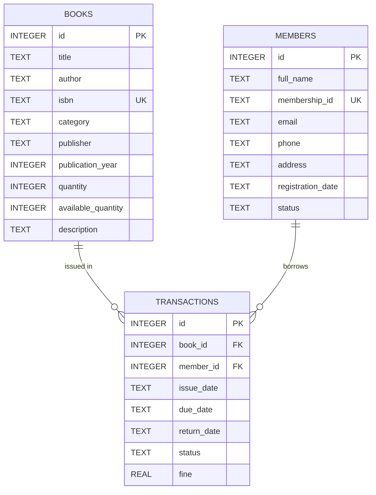

# Android Library Management System (Java & XML)

A comprehensive, production-grade native Android application for library administration built completely with **Java**, **Android XML layouts**, and **local SQLite**.

Designed for colleges, universities, and schools, the system operates **100% offline** without any requirement for cloud services, external servers, or internet access.

---

## Features

- **Dynamic Statistics Dashboard:**
  - Real-time calculation of total book titles, physical copies, available copies, active loans, registered members, and overdue loans directly from SQLite.
  - Zero hardcoded counts; counts refresh on return to dashboard.
- **Book Inventory Management (CRUD):**
  - Add, edit, view, and safely delete books.
  - Comprehensive metadata: Title, Author, ISBN (unique), Category/Genre, Publisher, Year, Total Quantity, Available Quantity, Description.
  - Real-time search by title, author, ISBN, or category.
  - Referential integrity check: prevents deleting books with active loans.
  - Stock consistency validation: prevents reducing total copies below currently loaned copies.
- **Member Directory Management (CRUD):**
  - Add, view, edit, and deactivate/delete members.
  - Attributes: Full Name, Membership ID (unique), Email, Phone, Address, Registration Date, Status (Active/Inactive).
  - Search by name, membership ID, email, or phone.
  - Referential integrity check: prevents deleting members who have active unreturned books.
- **Atomic Book Issue Flow:**
  - Dropdown selection of active members and books with available copies (> 0).
  - Issue date and due date pickers (defaults to 14 days loan duration).
  - Database transactions guarantee inventory decrement and loan record creation succeed or roll back together.
  - Double-submission prevention.
- **Book Return & Fine Processing:**
  - Searchable list of active loans.
  - Overdue fine calculation: **Rs. 10.00 per calendar day** overdue.
  - Safe confirmation modal displaying fine breakdown before processing.
  - Atomic stock increment and loan closure.
- **Transaction History & Filter Chips:**
  - Comprehensive history of all issues and returns.
  - Quick filter chips: **All**, **Issued**, **Returned**, **Overdue**.
  - Multi-attribute search by transaction ID, book title, or borrower name.
  - Data persists indefinitely across application closures.

---

## Technology Stack

| Component | Technology |
|---|---|
| **Language** | Java (Java 11 / Java 17 / Java 21+ compatible) |
| **UI Framework** | Native Android XML layouts |
| **Design System** | Google Material Components (`com.google.android.material`) |
| **Database** | SQLite via native Android `SQLiteOpenHelper` |
| **List Views** | AndroidX `RecyclerView` with `CardView` |
| **Build System** | Gradle 9.6.0 with Android Gradle Plugin 9.4.1 |
| **Minimum SDK** | API 24 (Android 7.0 Nougat) |
| **Target / Compile SDK** | API 35 / API 37 |
| **Architecture** | Native MVC with Model entity layer and SQLite OpenHelper DAO |

---

## Database Architecture

The local database (`library_management.db`) enables SQLite foreign keys with three relational tables:



---

## Project Structure

```
Android-Library-Management-System-Java-XML/
├── LICENSE
├── README.md
├── .gitignore
├── settings.gradle
├── build.gradle
├── gradle.properties
├── gradlew
├── gradlew.bat
├── gradle/
│   ├── gradle-daemon-jvm.properties
│   └── wrapper/
│       ├── gradle-wrapper.jar
│       └── gradle-wrapper.properties
└── app/
    ├── build.gradle
    ├── proguard-rules.pro
    └── src/
        ├── test/
        │   └── java/com/example/librarymanagement/
        │       └── LibraryBusinessLogicTest.java
        └── main/
            ├── AndroidManifest.xml
            ├── java/com/example/librarymanagement/
            │   ├── MainActivity.java
            │   ├── BooksActivity.java
            │   ├── AddEditBookActivity.java
            │   ├── MembersActivity.java
            │   ├── AddEditMemberActivity.java
            │   ├── IssueBookActivity.java
            │   ├── ReturnBookActivity.java
            │   ├── HistoryActivity.java
            │   ├── DatabaseHelper.java
            │   ├── Book.java
            │   ├── Member.java
            │   ├── LibraryTransaction.java
            │   ├── BookAdapter.java
            │   ├── MemberAdapter.java
            │   └── TransactionAdapter.java
            └── res/
                ├── drawable/
                │   ├── bg_avatar_circle.xml
                │   ├── bg_badge_active.xml
                │   ├── bg_badge_inactive.xml
                │   ├── bg_badge_issued.xml
                │   ├── bg_badge_overdue.xml
                │   ├── bg_badge_returned.xml
                │   ├── bg_header_gradient.xml
                │   ├── bg_search_bar.xml
                │   ├── bg_stat_card.xml
                │   ├── ic_add.xml
                │   ├── ic_arrow_back.xml
                │   ├── ic_book.xml
                │   ├── ic_calendar.xml
                │   ├── ic_check.xml
                │   ├── ic_delete.xml
                │   ├── ic_edit.xml
                │   ├── ic_history.xml
                │   ├── ic_issue.xml
                │   ├── ic_launcher_background.xml
                │   ├── ic_launcher_foreground.xml
                │   ├── ic_library_logo.xml
                │   ├── ic_person.xml
                │   ├── ic_return.xml
                │   ├── ic_search.xml
                │   └── ic_warning.xml
                ├── layout/
                │   ├── activity_main.xml
                │   ├── activity_books.xml
                │   ├── activity_add_edit_book.xml
                │   ├── activity_members.xml
                │   ├── activity_add_edit_member.xml
                │   ├── activity_issue_book.xml
                │   ├── activity_return_book.xml
                │   ├── activity_history.xml
                │   ├── item_book.xml
                │   ├── item_member.xml
                │   └── item_transaction.xml
                ├── mipmap-anydpi-v26/
                │   ├── ic_launcher.xml
                │   └── ic_launcher_round.xml
                ├── mipmap-hdpi/
                ├── mipmap-mdpi/
                ├── mipmap-xhdpi/
                ├── mipmap-xxhdpi/
                ├── mipmap-xxxhdpi/
                └── values/
                    ├── colors.xml
                    ├── dimens.xml
                    ├── strings.xml
                    └── themes.xml
```

---

## Prerequisites

1. **Android Studio**: Android Studio Hedgehog, Iguana, Jellyfish, Koala, Ladybug, Meerkat, or newer.
2. **Java Development Kit (JDK)**: JDK 11, 17, or 21+ (bundled inside Android Studio as JBR).
3. **Android SDK**: API 24 or newer platform installed via Android Studio SDK Manager.

---

## Instructions to Open the Project in Android Studio

1. Open **Android Studio**.
2. Select **File → Open...** (or click **Open** on the Welcome screen).
3. Navigate to and select the project folder:
   `Android-Library-Management-System-Java-XML`
4. Click **OK**.
5. Android Studio will automatically recognize the Gradle build, download dependencies, and perform project sync.

---

## Instructions to Build and Run the App

### Option A: From Android Studio (Recommended)

1. Connect a physical Android device via USB (with **USB Debugging** enabled in Developer options) OR select an Android Emulator (e.g., Pixel 7 / API 34+).
2. Click the green **Run** button (`▶`) or press `Shift + F10`.
3. Android Studio builds the app, deploys the APK, and launches `MainActivity`.

### Option B: From Command Line (Terminal / PowerShell)

To assemble the debug build and execute automated unit tests:

```powershell
# Windows PowerShell
.\gradlew.bat assembleDebug
.\gradlew.bat testDebugUnitTest

# macOS / Linux
./gradlew assembleDebug
./gradlew testDebugUnitTest
```

To install directly to a connected device or running emulator:

```powershell
.\gradlew.bat installDebug
```

---

## Generating the Debug APK

To generate a standalone APK in Android Studio:
1. Go to the top menu: **Build → Build Bundle(s) / APK(s) → Build APK(s)**.
2. When the build completes, click the **locate** popup notification.
3. The APK will be available at:
   ```
   app/build/outputs/apk/debug/app-debug.apk
   ```

---

## Offline Guarantee & Data Persistence

This application is strictly self-contained:
- All database queries, insertions, transactions, and searches occur entirely on device using SQLite.
- No network requests, external APIs, cloud credentials, or tracking libraries are included.
- All seeded and user-created data persists safely between application restarts.

---

## Design System & Theme Guidelines

The application follows Google Material Components standards:
- **Consistent Tokens**: Semantic color naming in `colors.xml` separates text, accent, and status indicators.
- **Visual Feedback**: Ripple interaction highlights on cards and lists for responsive tactile feel.
- **Input Validation**: Clear error messaging and inline assistive helper hints for date pickers and form fields.

---

## License

This project is licensed under the terms of the [MIT License](LICENSE).

